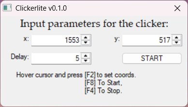

# Clickerlite 🚀

An ultra-fast, minimalist auto-clicker built with PureBasic. No bloat, no extra features—just pure performance.

## Features ✨
- **Lightning Fast**: Powered by low-level Windows APIs and multi-threading.
- **Minimalist UI**: Clean, lightweight interface designed to stay out of your way.
- **Portable**: Requires no installation. Just download the `.exe` and run it from anywhere (even from a USB flash drive!).
- **Global Hotkeys**: Control the clicker globally, even when games or other apps are in focus.

## How to Use 🕹️

1. **Set Coordinates**: Hover your mouse cursor over the target and press **`[F2]`** to capture coordinates automatically (or enter them manually in the `x` and `y` fields).
2. **Set Delay**: Specify the click interval in milliseconds in the **`Delay`** field (e.g., `Delay = 5` means 1 click every 5 ms, which is up to 200 clicks per second).
3. **Control**: 
   - Press **`[F8]`** to Start.
   - Press **`[F4]`** to Stop.

## Hotkeys Summary ⌨️
| Key | Action |
| :--- | :--- |
| `F2` | Capture mouse coordinates |
| `F8` | Start auto-clicking |
| `F4` | Stop auto-clicking |

## Download & Releases 📦
You can download the latest pre-compiled executable from the [Releases](../../releases) page. 
- **Compatibility**: Windows (x86 / x64)

## Disclaimer ⚠️
*Use responsibly. The author is not responsible for any bans or issues caused by using this tool in games or applications.*